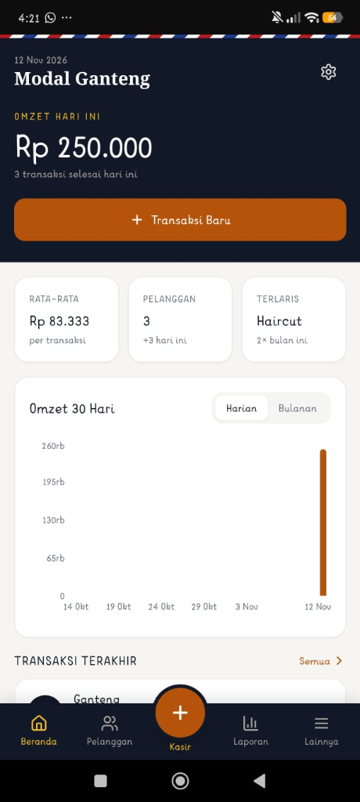

# 🏪 POS Barbershop — Landing Page

Landing page high-conversion untuk menjual aplikasi POS Barbershop. Dibangun dengan Next.js 14, Tailwind CSS, dan Framer Motion.



## ✨ Fitur Landing Page

- 🎨 **Desain Premium** — Dark theme, glassmorphism, neon glow effects
- 📱 **Mobile-First** — Responsive di semua device
- 💳 **Payment Gateway** — Integrasi Midtrans Snap.js (sandbox ready)
- 🔍 **SEO Optimized** — Metadata, JSON-LD, sitemap, robots.txt
- 💬 **WhatsApp Integration** — Floating button + konsultasi link
- 🚀 **Framer Motion** — Smooth animations & scroll effects
- ⏱️ **Urgency Elements** — Countdown timer, harga coret, badge diskon

## 🛠️ Tech Stack

| Technology | Purpose |
|---|---|
| Next.js 14+ | Framework (App Router) |
| TypeScript | Type safety |
| Tailwind CSS | Styling |
| Framer Motion | Animations |
| Lucide React | Icons |
| Midtrans | Payment Gateway |

## 📦 Getting Started

### 1. Clone & Install

```bash
git clone <repo-url>
cd pos-barbershop-landing
npm install
```

### 2. Setup Environment Variables

Copy file `.env.example` ke `.env.local`:

```bash
cp .env.example .env.local
```

Edit `.env.local` dan isi dengan value yang sesuai:

```env
# Midtrans (daftar di https://dashboard.midtrans.com)
MIDTRANS_SERVER_KEY=SB-Mid-server-xxxxx
MIDTRANS_CLIENT_KEY=SB-Mid-client-xxxxx
NEXT_PUBLIC_MIDTRANS_CLIENT_KEY=SB-Mid-client-xxxxx

# WhatsApp (ganti dengan nomor Anda)
NEXT_PUBLIC_WHATSAPP_NUMBER=6281234567890

# Base URL
NEXT_PUBLIC_BASE_URL=http://localhost:3000
```

### 3. Run Development Server

```bash
npm run dev
```

Buka [http://localhost:3000](http://localhost:3000).

### 4. Build for Production

```bash
npm run build
```

## 🚀 Deploy ke Netlify

### Cara 1: Netlify CLI

```bash
npm install -g netlify-cli
netlify deploy --prod
```

### Cara 2: Netlify Dashboard

1. Push code ke GitHub
2. Login ke [app.netlify.com](https://app.netlify.com)
3. New Site → Import from Git → Pilih repo
4. Build command: `npm run build`
5. Publish directory: `.next`
6. Tambahkan environment variables di Netlify Dashboard
7. Deploy!

### Environment Variables di Netlify

Di Netlify Dashboard → Site Settings → Build & Deploy → Environment:

| Variable | Value |
|---|---|
| `MIDTRANS_SERVER_KEY` | Production server key dari Midtrans |
| `MIDTRANS_CLIENT_KEY` | Production client key dari Midtrans |
| `NEXT_PUBLIC_MIDTRANS_CLIENT_KEY` | Sama dengan MIDTRANS_CLIENT_KEY |
| `NEXT_PUBLIC_WHATSAPP_NUMBER` | Nomor WA Anda (format: 628xxx) |
| `NEXT_PUBLIC_BASE_URL` | URL site Netlify Anda |

## 💳 Setup Midtrans

### 1. Daftar Akun
- Buka [https://dashboard.midtrans.com](https://dashboard.midtrans.com)
- Daftar akun baru (gratis)

### 2. Dapatkan API Keys
- Login ke Dashboard
- Pilih **Sandbox** (untuk testing) atau **Production** (untuk live)
- Masuk ke **Settings → Access Keys**
- Copy **Server Key** dan **Client Key**

### 3. Ganti dari Sandbox ke Production
Saat sudah siap live:
1. Ganti env vars ke production keys
2. Di `layout.tsx`, ganti Snap.js URL:
   ```
   Dari: https://app.sandbox.midtrans.com/snap/snap.js
   Ke:   https://app.midtrans.com/snap/snap.js
   ```
3. Di `create-transaction/route.ts`, ganti API URL:
   ```
   Dari: https://app.sandbox.midtrans.com/snap/v1/transactions
   Ke:   https://app.midtrans.com/snap/v1/transactions
   ```

## 📝 Kustomisasi

### Ganti Nomor WhatsApp
Cari semua `// TODO: Ganti nomor WA` di code, atau ubah di `.env.local`:
```env
NEXT_PUBLIC_WHATSAPP_NUMBER=628xxxxxxxxxx
```

### Ganti Dummy Data
Cari semua `// DUMMY: Ganti dengan data real` di code:
- Testimoni di `Testimonials.tsx`
- Statistik counter di `WhyChooseUs.tsx`
- Screenshot di `AppPreview.tsx`

### Ganti Screenshot Aplikasi
Taruh screenshot real di folder `public/images/` dan update referensi di komponen:
- `HeroSection.tsx` — Phone mockup
- `Features.tsx` — Mockup per fitur
- `AppPreview.tsx` — Tab carousel

### Ganti OG Image
Buat gambar 1200x630px dan simpan di `public/images/og-image.png`

## 📁 Struktur Project

```
src/
├── app/
│   ├── layout.tsx          # Layout + SEO + JSON-LD
│   ├── page.tsx            # Halaman utama (assembly)
│   ├── globals.css         # Global styles
│   ├── sitemap.ts          # Auto-generated sitemap
│   ├── success/
│   │   └── page.tsx        # Halaman sukses pembayaran
│   └── api/payment/
│       ├── create-transaction/route.ts  # Create Midtrans transaction
│       └── notification/route.ts        # Midtrans webhook handler
├── components/
│   ├── Navbar.tsx           # Sticky navbar
│   ├── HeroSection.tsx      # Hero section full viewport
│   ├── PainPoints.tsx       # Problem/pain points
│   ├── Features.tsx         # Fitur utama
│   ├── WhyChooseUs.tsx      # Keunggulan + counter
│   ├── AppPreview.tsx       # Preview screenshot app
│   ├── Pricing.tsx          # Kartu harga
│   ├── Testimonials.tsx     # Carousel testimoni
│   ├── FAQ.tsx              # Accordion FAQ
│   ├── CTAFinal.tsx         # CTA closing + countdown
│   ├── Footer.tsx           # Footer
│   ├── WhatsAppFloat.tsx    # Floating WA + scroll-to-top
│   ├── StickyMobileCTA.tsx  # Sticky bottom bar mobile
│   └── PaymentModal.tsx     # Modal form pembayaran
└── lib/                     # Helper utilities
```

## 📄 License

© 2025 POS Barbershop. All rights reserved.
